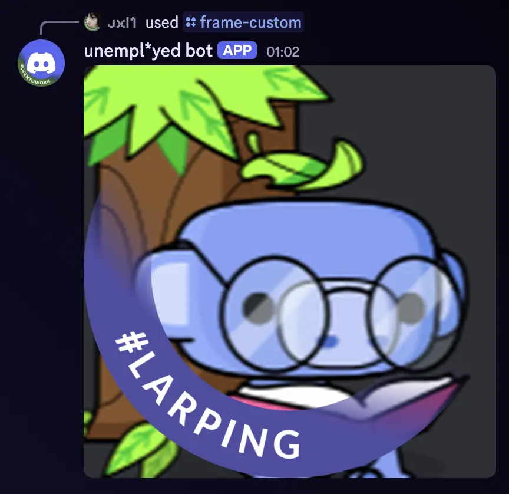

# linkedin-frame

Apply LinkedIn-style circular frames with custom arc text to profile pictures — as a **Discord bot**, a **browser-based web app**, and a **serverless MCP tool** hosted on Vercel.

Supports both static images and animated GIFs.

The web app and Python image processor center-crop images without stretching.
PNG and GIF exports are square, with each side equal to the smaller original
dimension. GIF timing is preserved, and Discord GIF avatars are fetched without
requesting an enlarged 1024px version. Re-encoding can still change file size.

 

## Web app

**https://linkedin-frame.vercel.app/**

Upload any image or GIF, pick a color and arc text, and download the result.

## MCP server

Connect an MCP client using Streamable HTTP at **https://linkedin-frame.vercel.app/api/mcp**.

The `frame_avatar` tool calls the existing `lib.process.process_avatar` function:

| Argument | Description |
|-----------|-------------|
| `image_base64` | Required raw base64 image bytes, without a `data:` URL prefix |
| `color` | Six-digit hex color, default `#457032` |
| `text` | Arc text (up to 80 characters), default `#OPENTOWORK` |

The result is MCP image content: PNG for static images, GIF for animated images.
Inputs are limited to 3 MiB, 30 frames, and 20 million total pixels; output is
limited to 10 MiB before base64 encoding. JSON responses are streamed in chunks
to support outputs above Vercel's buffered response limit. The request-body
limit includes room for base64 expansion and the MCP envelope. Images are
processed in memory without being stored. The endpoint is public and does not
require authentication. MCP clients may impose their own response-size limits.

### Deploy to Vercel

Import this repository with the **Other** framework preset, or run:

```bash
vercel --prod
```

`vercel.json` copies only the web app's HTML, JavaScript, and assets into the
static output directory and deploys `api/mcp.py` and `api/discord.py` as Python
3.12 functions. No environment variables are required for the website or MCP
server. Discord interactions require only `DISCORD_PUBLIC_KEY`; keep the bot's
`DISCORD_TOKEN` local for command registration.

For local MCP development and tests, after installing the dependencies below:

```bash
.venv/bin/python -m uvicorn api.mcp:app --reload
.venv/bin/python -m unittest discover -s tests -v
```

The local endpoint is `http://localhost:8000/api/mcp`.

## Discord bot

### Commands

#### `/frame-custom`
Apply a custom-colored frame with custom arc text to a user's profile picture.

| Parameter | Description |
|-----------|-------------|
| `user` | The Discord member whose profile picture to use |
| `color` | Frame color as a hex code (e.g. `#5865F2`) |
| `text` | Text to display on the arc |

#### `/frame-opentowork`
Apply the LinkedIn `#OPENTOWORK` frame (green, `#457032`) to a user's profile picture.

| Parameter | Description |
|-----------|-------------|
| `user` | The Discord member whose profile picture to use |

### Setup

#### Vercel HTTP interactions (recommended)

The hosted bot receives slash commands at:

**https://linkedin-frame.vercel.app/api/discord**

It does not open a Gateway connection or require a continuously running bot
process. Requests are verified with Discord's Ed25519 public key. Commands are
acknowledged immediately with a deferred response, then the result is uploaded
to the original response over HTTP. PNG and animated GIF avatars are supported,
including server-specific avatars and Discord's default avatars.

To configure another deployment:

1. Set `DISCORD_PUBLIC_KEY` in Vercel's production environment using the public
   key from your application's General Information page in the Discord Developer
   Portal, then deploy.
2. Set the application's **Interactions Endpoint URL** to your deployment's
   `/api/discord` URL. Discord verifies the endpoint with a signed ping.
3. Register or update the slash commands locally, using `DISCORD_TOKEN` in `.env`:

   ```bash
   .venv/bin/python main.py --sync-commands
   ```

Command registration uses REST and exits without connecting to the Gateway.
After configuring the endpoint, stop the old Gateway bot process if it is still
running. Interaction delivery switches from Gateway to HTTP for the application.

The serverless handler accepts up to 80 arc-text characters and avatars up to
8 MiB, 120 frames, and 100 million total input pixels. Work must finish within
the function's 60-second lifetime; processing failures update the deferred
response with an error. Images are processed in memory and are not stored.

For local development, export `DISCORD_PUBLIC_KEY` and run:

```bash
.venv/bin/python -m uvicorn api.discord:app --reload
```

#### Docker HTTP server

**1. Create a `.env` file:**
```
DISCORD_PUBLIC_KEY=your_application_public_key
```

**2. Run with Docker Compose:**
```bash
docker compose up --build -d --remove-orphans
```

One container serves all three endpoints:

| URL | Purpose |
|-----|---------|
| `http://localhost:8080/` | Web app |
| `http://localhost:8080/api/discord` | Signed Discord interactions |
| `http://localhost:8080/api/mcp` | Streamable HTTP MCP server |

The runtime needs only the public key. The bot token is not passed to the
container. `--remove-orphans` removes the old Gateway bot service when upgrading
an existing Compose deployment.

To receive Discord interactions on this container, expose port 8080 through a
public HTTPS reverse proxy or tunnel and configure that URL's `/api/discord` as
the application's Interactions Endpoint URL. This switches command delivery
away from Vercel. If exposing MCP on a public hostname, also set
`MCP_HOST=your-domain.example` in `.env` so its host and origin checks accept it.

To register commands without installing Python locally, export `DISCORD_TOKEN`
in your shell and run:

```bash
docker compose run --rm --env DISCORD_TOKEN web python main.py --sync-commands
```

#### Manual Gateway mode

**1. Install dependencies**
```bash
python3.12 -m venv .venv
.venv/bin/pip install -r requirements.txt
```

**2. Configure environment**

Create a `.env` file at the project root:
```
DISCORD_TOKEN=your_bot_token_here
```

**3. Run**
```bash
.venv/bin/python3 main.py
```

Slash commands are synced globally on startup.

## Project structure

```
main.py           # Optional Gateway bot; --sync-commands registers commands via REST
lib/
  commands.py     # Shared frame colors, website URL, and color parsing
  frame.py        # Applies colored ring frame using assets/alpha.png
  text.py         # Renders text along a circular arc
  process.py      # Combines frame + text, handles static and animated GIFs
assets/
  alpha.png       # Frame alpha mask (grayscale: white = frame, black = avatar)
  Carlito-Bold.ttf
index.html        # Web app
js/
  app.js          # Web app logic (mirrors lib/ in the browser)
  vendor/         # gif.js, gif.worker.js, omggif.js
api/mcp.py        # Stateless Streamable HTTP MCP server, reuses lib/process.py
api/discord.py    # Signed Discord HTTP interactions and deferred image replies
docker_app.py     # Combined website, Discord, and MCP application for Docker
vercel.json       # Static web output and Python function configuration
tests/test_mcp.py # MCP transport, image output, and validation tests
tests/test_discord.py # Discord signatures, command dispatch, and PNG/GIF replies
```
